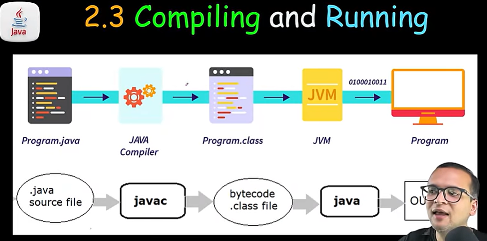
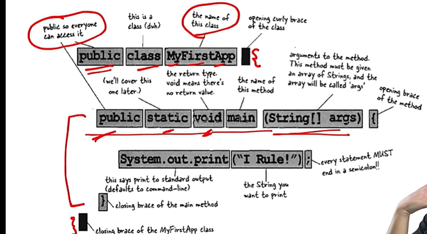
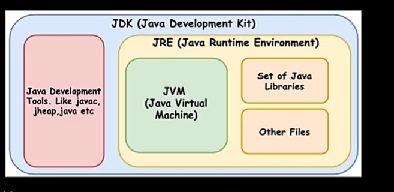

PROGRAMMING LANGUAGE

computer only understand 0/1 or off/on

Human instructions are given in high level lang 

compiler converts high level lang to low level lang or machine code

problem --> human instructions --> 0101010101 -->solve 

programming lang = human instruction + 01010101010

Jaab bhi kisi problem ko solve karne ke liye hum step by step instruction likhte hain usko hum alogoritm kehte hai

Algorithm = step by step procedure for solving a problem or performing a task

SYNTAX 

rule of the language 
structure of words in a sentence 

James Gosling at Sun Microsystems 

WRITE ONCE , RUN ANYWHERE 

Cross platform compatibility

java program (myprogram.java) --> compiler (HLL to LLL(01010101) ) --> interpreter --> any device 

Oak to Java (because of coffee beans , as it doesnt change the taste even after multiple boils , or cooling unlike tea)

forward compatibility v/s backward compatibility 

source code (human written) --> compiler -->byte code (verified code , non human readable) --> JVM (converts to 0101010101 for each machine)(M1, M2, M3, M4)

Very Imp feature of JAVA

1. Portability : write once run anywhere 

2. Security :  because it runs on virtual machine JVM , very secure , sandboxing 

3. Robust : strong memory management , exception handling and type checking mechanism which helps in preventing such crashes and ensuring the performance 

4. Multithreaded :  is ability of a cpu to execute multiple threads concurrently(ekk sath) , allowing for more efficient processing and task management 

5. Architecture neutral :  java is architecturally neutral because its compiled code (byte code) can run on any device with a JVM regardless of the underlying hardware architecture 

6. Interepreted and high performance :  java combines high performance with interpretability as its bytecode is interpeted by the jvm , which deploys Just-in-time (JIT)

7. Distributed : designed to facilitate network based application development and interaction , seamless integrating with internet protocol

OBJECT ORIENTED PROGRAMMING 

It has class , object , properties , methods 

FIRST CLASS USING TEXT EDITOR

import java.lang.*;

public class FirstProgram {
  public static void main(String[] args){
   System.out.print("Welcome to my vlog");
}
}

Byte code is always saved in .class extension 

program.java --> java compiler --> program.class -->jvm(000111000)-->program

.java source file(input) --> javac (command) --> bytecode.class file (command ) ---> java --> output

Anatomy of a class 

public --> public keyword means everyone can access it 

class --> keyword , to define a class then <className>

void --> means return type 
 
 

File extensions

.java 

it contains java source code
high level human readable
used for development 
file is editable 

.class 

contains java bytecode
for consumtion of jvm
used for execution
not meant to be edited

JDK vs JVM vs JRE 

